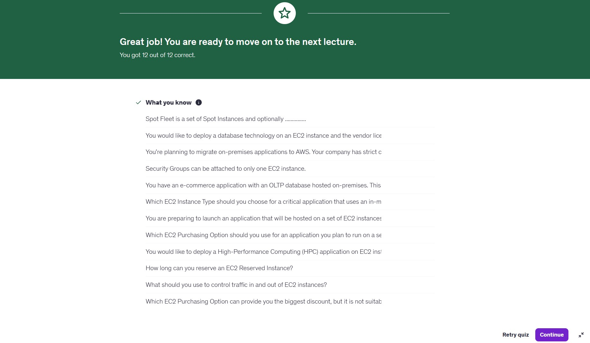
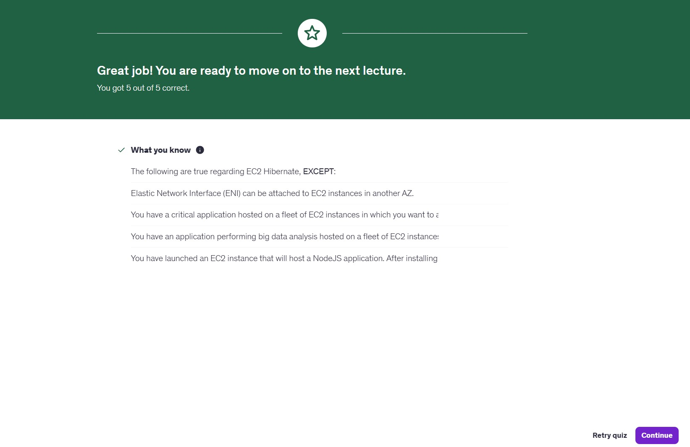
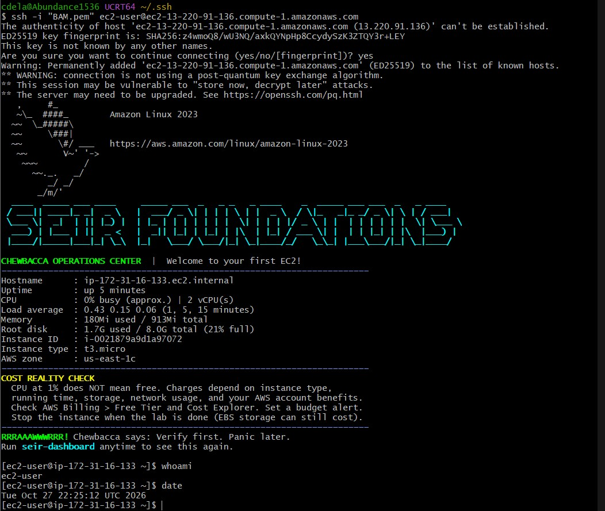
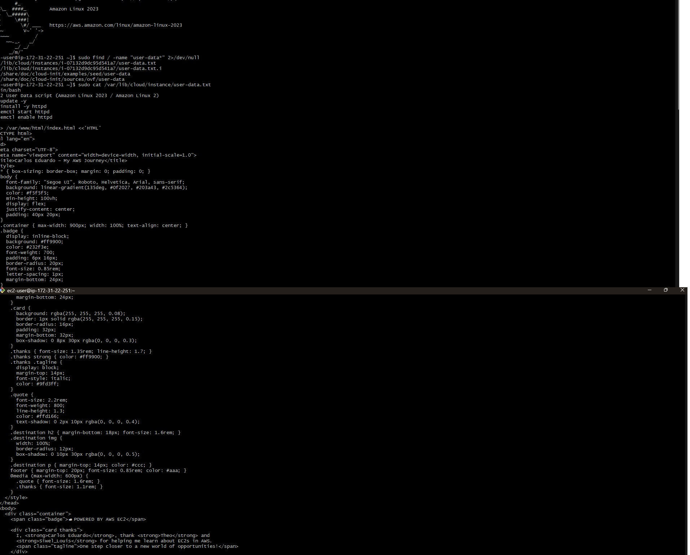

# Lab 0.5 - Catch Up, Find Your Team, Prove Your Work

**Student:** Carlos Eduardo
**Instructor:** Theo
**Spotter:** Siwel_Louis

---

## Table of Contents
1. [General – Group Verification](#1-general--group-verification)
2. [Udemy (Stéphane Maarek) Quiz](#2-udemy-stéphane-maarek-quiz)
   - [Maarek_Section5_quiz.jpg](./screenshots/Maarek_Section5_quiz.jpg)
   - [Maarek_Section6_quiz.jpg](./screenshots/Maarek_Section6_quiz.jpg)
3. ["Be A Man" Extra Credit](#3-be-a-man-extra-credit)
   - [BAM_1.1 – SSH Connection to EC2](#bam_11--ssh-connection-to-ec2)
   - [BAM_1.2 – Customized EC2 Webpage](#bam_12--customized-ec2-webpage)
   - [BAM_1.3 – Display the user_data Script via SSH](#bam_13--display-the-user_data-script-via-ssh)
4. [Submission Checklist](#4-submission-checklist)
5. [Folder Structure](#5-folder-structure)

---

## 1. General – Group Verification

Group membership and assignments verified per the
[Lab 0.5 README](https://github.com/BalericaAI/SEIR-Foundations/blob/main/module1/lab0_basics/lab0.5_README.md).

| File | Description |
|------|-------------|
| [`group_CarlosEduardo.txt`](./group_CarlosEduardo.txt) | Group information (all values filled in) |

---

## 2. Udemy (Stéphane Maarek) Quiz

### Section 5 Quiz – [`Maarek_Section5_quiz.jpg`](./screenshots/Maarek_Section5_quiz.jpg)


### Section 6 Quiz – [`Maarek_Section6_quiz.jpg`](./screenshots/Maarek_Section6_quiz.jpg)


---

## 3. "Be A Man" Extra Credit

### BAM_1.1 – SSH Connection to EC2

Connected to the EC2 instance with a **local SSH client** (Git Bash on Windows), **not** EC2 Instance Connect, and ran `whoami` and `date`.

```bash
chmod 400 "BAM.pem"
ssh -i "BAM.pem" ec2-user@<EC2-Public-DNS>
whoami
date
```



---

### BAM_1.2 – Customized EC2 Webpage

Apache (`httpd`) web server deployed on Amazon Linux 2023 through an EC2 **User Data** script. The page shows:

- *"I, **Carlos Eduardo**, Thank **Theo** And **Siwel_Louis**, for helping me learn about EC2s in AWS. One step closer to a new world of opportunities!"*
- *"With This Class, I Will Net **$630,000** Per Year!"*
- My destination after making Cloud Money and paying my bills: **Italy** 🇮🇹


---

### BAM_1.3 – Display the user_data Script via SSH

From a local SSH session at home, I found the `user_data` script on the running EC2 instance and printed it with `cat`.

cloud-init stores the instance's user data at:
`/var/lib/cloud/instance/user-data.txt`
(a link to `/var/lib/cloud/instances/<instance-id>/user-data.txt`)

```bash
# Locate the user data file
sudo find / -name "user-data*" 2>/dev/null

# Display the user data script
sudo cat /var/lib/cloud/instance/user-data.txt
```

> `sudo` is required because the file is readable only by root.



---

## 4. Submission Checklist

| Item | File | Status |
|------|------|:------:|
| Group file | `group_CarlosEduardo.txt` | ✅ |
| Maarek Section 5 quiz | `screenshots/Maarek_Section5_quiz.jpg` | ✅ |
| Maarek Section 6 quiz | `screenshots/Maarek_Section6_quiz.jpg` | ✅ |
| BAM_1.1 – SSH + `whoami` / `date` | `screenshots/BAM_1.1.jpg` | ✅ |
| BAM_1.2 – Custom webpage | `screenshots/BAM_1.2.jpg` | ✅ |
| BAM_1.3 – `cat` user_data | `screenshots/BAM_1.3.jpg` | ✅ |

---

## 5. Folder Structure

```
seir-foundations-labs/
└── module1/
    ├── lab0_basics/
    └── lab0.5_basics_contd/
        ├── README.md
        ├── group_CarlosEduardo.txt
        └── screenshots/
            ├── BAM_1.1.jpg      (extra credit)
            ├── BAM_1.2.jpg      (extra credit)
            ├── BAM_1.3.jpg      (extra credit)
            ├── Maarek_Section5_quiz.jpg
            └── Maarek_Section6_quiz.jpg
```

---

### Tools Used
- AWS EC2 (Amazon Linux 2023)
- Apache HTTP Server (`httpd`)
- cloud-init / EC2 User Data
- Git Bash (OpenSSH client)

> 🔒 **Security note:** The `.pem` private key is **not** included in this repository.
