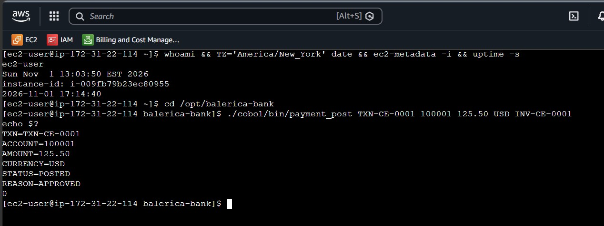
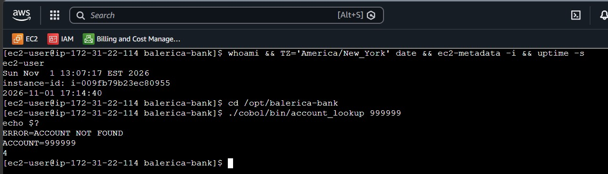
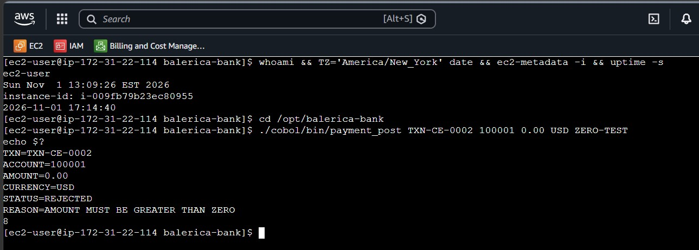
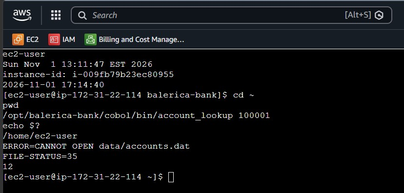
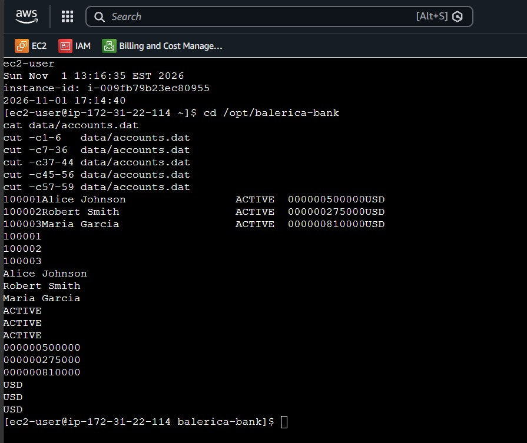
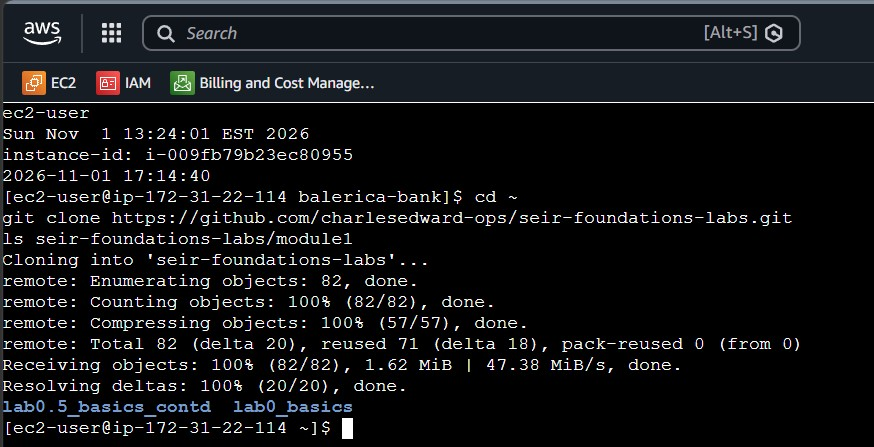

# Lesson 1 - EC2: Balerica Legacy Bank (FastAPI + COBOL Core)

**Student:** Carlos Eduardo
**Instructor:** Theo
**Spotter:** _SpotterNameHere_
**Time zone:** America/New_York

---

## Table of Contents
1. [Lab Runs (x7)](#lab-runs)
   - [lab1_run1.jpg – lab1_run7.jpg](#lab-runs)
2. [COBOL Core Practice](#cobol-practice)
   - [cobol_rc0.jpg](#cobol-rc0)
   - [cobol_rc4.jpg](#cobol-rc4)
   - [cobol_rc8.jpg](#cobol-rc8)
   - [cobol_rc12.jpg](#cobol-rc12)
   - [cobol_ledger_decode.jpg](#cobol-ledger-decode)
3. [Git Clone on EC2](#git-clone)
   - [git_clone.jpg](#git-clone)
4. [Text Submissions](#text-submissions)
5. [Udemy (Stéphane Maarek) Quiz](#maarek-quiz)
   - [Maarek_Section21_quiz.jpg](#maarek-section21-quiz)
   - [Maarek_Section23_quiz.jpg](#maarek-section23-quiz)
   - [Maarek_Section25_quiz.jpg](#maarek-section25-quiz)
6. ["Be A Man" Extra Credit](#bam)
   - [BAM_2.1.jpg](#bam-2-1)
   - [BAM_2.2.jpg](#bam-2-2)
   - [BAM_2.3.jpg](#bam-2-3)
7. [Submission Checklist](#submission-checklist)
8. [Folder Structure](#folder-structure)

---

<a id="lab-runs"></a>
## 1. Lab Runs (x7)

Each run is a **brand-new EC2 instance** with Steps 0–4 of the
[Balerica Legacy Bank Student Runbook](https://github.com/BalericaAI/SEIR-Foundations/blob/main/module1/lesson1_ec2/API/runbook.md)
completed by hand (no baked launch template or golden AMI).

ID line, run right before starting uvicorn:

```bash
whoami && TZ='America/New_York' date && ec2-metadata -i && uptime -s
uvicorn app.main:app --host 0.0.0.0 --port 8000
```

| Run | Date | Time zone | Instance ID | Boot time (UTC) | Public IPv4 DNS | Screenshot | Terminated? |
|:---:|------|-----------|-------------|-----------------|-----------------|------------|:-----------:|
| 1 | 2026-10-31 | America/New_York | `i-0c7c062d3ad3d66d5` | 2026-10-31 17:11:52 | `ec2-54-237-215-227.compute-1.amazonaws.com` | [lab1_run1.jpg](./screenshots/lab1_run1.jpg) | ✅ |
| 2 | 2026-10-31 | America/New_York | `i-00066206f7feebf52` | 2026-10-31 18:03:06 | `ec2-54-89-54-30.compute-1.amazonaws.com` | [lab1_run2.jpg](./screenshots/lab1_run2.jpg) | ✅ |
| 3 | 2026-10-31 | America/New_York | `i-0a031128731725ade` | 2026-10-31 18:29:07 | `ec2-54-204-121-210.compute-1.amazonaws.com` | [lab1_run3.jpg](./screenshots/lab1_run3.jpg) | ✅ |
| 4 | 2026-11-01 | America/New_York | `i-0852c3271ac4dfc45` | 2026-11-01 16:00:50 | `ec2-3-95-39-202.compute-1.amazonaws.com` | [lab1_run4.jpg](./screenshots/lab1_run4.jpg) | ✅ |
| 5 | 2026-11-01 | America/New_York | `i-0879f1f31633df516` | 2026-11-01 17:00:36 | `ec2-34-224-168-12.compute-1.amazonaws.com` | [lab1_run5.jpg](./screenshots/lab1_run5.jpg) | ✅ |
| 6 | 2026-11-01 | America/New_York | `i-009fb79b23ec80955` | 2026-11-01 17:14:40 | `ec2-54-234-96-95.compute-1.amazonaws.com` | [lab1_run6.jpg](./screenshots/lab1_run6.jpg) | ✅ |
| 7 | YYYY-MM-DD | America/New_York | i-xxxxxxxxxxxxxxxxx | YYYY-MM-DD HH:MM:SS | ec2-x-x-x-x.compute-1.amazonaws.com | [lab1_run7.jpg](./screenshots/lab1_run7.jpg) | ✅ |

> Instance ID and boot time match the screenshots exactly. Max 3 runs per day.
> After each run: instance terminated, no leftover EBS volumes or Elastic IPs. Launch template kept.

Personal notes for every run: [`lab1_notes.md`](./lab1_notes.md)

---

<a id="cobol-practice"></a>
## 2. COBOL Core Practice

Run on lab-run instance **Run 6 (`i-009fb79b23ec80955`)** in `/opt/balerica-bank`.
TXN IDs use my initials: `TXN-CE-0001`, `TXN-CE-0002`, ...

| Code | Meaning |
|:----:|---------|
| 0 | success — account found / payment POSTED |
| 4 | warning — account not found |
| 8 | business rejection — not ACTIVE, zero amount, insufficient funds |
| 12 | environment failure — missing file, malformed args, wrong folder |

<a id="cobol-rc0"></a>
### Return code 0 – Success – [`cobol_rc0.jpg`](./screenshots/cobol_rc0.jpg)
```bash
./cobol/bin/payment_post TXN-CE-0001 100001 125.50 USD INV-CE-0001
echo $?
```


<a id="cobol-rc4"></a>
### Return code 4 – Account not found – [`cobol_rc4.jpg`](./screenshots/cobol_rc4.jpg)
```bash
./cobol/bin/account_lookup 999999
echo $?
```


<a id="cobol-rc8"></a>
### Return code 8 – Business rejection (zero amount) – [`cobol_rc8.jpg`](./screenshots/cobol_rc8.jpg)
```bash
./cobol/bin/payment_post TXN-CE-0002 100001 0.00 USD ZERO-TEST
echo $?
```


<a id="cobol-rc12"></a>
### Return code 12 – Environment failure (wrong folder) – [`cobol_rc12.jpg`](./screenshots/cobol_rc12.jpg)
```bash
cd ~
/opt/balerica-bank/cobol/bin/account_lookup 100001
echo $?
```


<a id="cobol-ledger-decode"></a>
### Fixed-width ledger decoded by hand – [`cobol_ledger_decode.jpg`](./screenshots/cobol_ledger_decode.jpg)

| Columns | Field | PIC |
|---------|-------|-----|
| 1-6 | account id | X(6) |
| 7-36 | customer name | X(30) |
| 37-44 | status | X(8) |
| 45-56 | balance | 9(10)V99 (implied decimal) |
| 57-59 | currency | X(3) |

```bash
cut -c1-6   data/accounts.dat
cut -c7-36  data/accounts.dat
cut -c37-44 data/accounts.dat
cut -c45-56 data/accounts.dat
cut -c57-59 data/accounts.dat
```


Full COBOL write-up: [`lab1_notes.md` → COBOL practice](./lab1_notes.md#cobol-practice)

---

<a id="git-clone"></a>
## 3. Git Clone on EC2 – [`git_clone.jpg`](./screenshots/git_clone.jpg)

Cloned this HW repo onto lab-run instance **Run 6 (`i-009fb79b23ec80955`)** (clone only: no push from EC2, no GitHub token on the server).

```bash
git clone https://github.com/charlesedward-ops/seir-foundations-labs.git
ls seir-foundations-labs/module1
```


---

<a id="text-submissions"></a>
## 4. Text Submissions

| File | Contents |
|------|----------|
| [`lab1_notes.md`](./lab1_notes.md) | Notes for all 7 runs, COBOL practice, mistakes, commands, BAM |
| [`ai_review_CarlosEduardo.txt`](./ai_review_CarlosEduardo.txt) | AI review of the Lesson 1 runbook (5+ questions, how I checked each) |
| [`ai_review_transcript_CarlosEduardo.txt`](./ai_review_transcript_CarlosEduardo.txt) | Full AI conversation transcript (if no share link) |
| [`spotter_CarlosEduardo.txt`](./spotter_CarlosEduardo.txt) | What my spotter taught me / what I taught the person I spot |
| [`AI_enabled_study_lab1.0.txt`](./AI_enabled_study_lab1.0.txt) | Research: Databases, COBOL, SWIFT, APIs, and their intersection |

---

<a id="maarek-quiz"></a>
## 5. Udemy (Stéphane Maarek) Quiz

<a id="maarek-section21-quiz"></a>
### Section 21 Quiz – [`Maarek_Section21_quiz.jpg`](./screenshots/Maarek_Section21_quiz.jpg)


<a id="maarek-section23-quiz"></a>
### Section 23 Quiz – [`Maarek_Section23_quiz.jpg`](./screenshots/Maarek_Section23_quiz.jpg)


<a id="maarek-section25-quiz"></a>
### Section 25 Quiz – [`Maarek_Section25_quiz.jpg`](./screenshots/Maarek_Section25_quiz.jpg)


---

<a id="bam"></a>
## 6. "Be A Man" Extra Credit

Details and Instance IDs: [`lab1_notes.md` → BAM](./lab1_notes.md#bam)

<a id="bam-2-1"></a>
### BAM_2.1 – `/ask` answered by Amazon Bedrock – [`BAM_2.1.jpg`](./screenshots/BAM_2.1.jpg)
IAM role attached to the instance (no access keys); `AWS_REGION` and `BEDROCK_MODEL_ID` (inference profile `us.…`) set before uvicorn.


<a id="bam-2-2"></a>
### BAM_2.2 – Baked launch template (User Data installer) – [`BAM_2.2.jpg`](./screenshots/BAM_2.2.jpg)
New launch template whose User Data clones the repo and runs the installer at boot. Shows `Installation complete.` in `/var/log/cloud-init-output.log` and a working COBOL account lookup.


<a id="bam-2-3"></a>
### BAM_2.3 – Golden AMI – [`BAM_2.3.jpg`](./screenshots/BAM_2.3.jpg)
Image created from a configured instance; new instance launched from the AMI starts uvicorn with no installer. AMI deregistered and snapshot deleted afterward.


---

<a id="submission-checklist"></a>
## 7. Submission Checklist

| Item | File | Status |
|------|------|:------:|
| Lab runs 1–7 | `screenshots/lab1_run1.jpg` … `lab1_run7.jpg` | ⬜ |
| Run table | `README.md` (this file) | ⬜ |
| Notes | `lab1_notes.md` | ⬜ |
| COBOL RC 0 | `screenshots/cobol_rc0.jpg` | ⬜ |
| COBOL RC 4 | `screenshots/cobol_rc4.jpg` | ⬜ |
| COBOL RC 8 | `screenshots/cobol_rc8.jpg` | ⬜ |
| COBOL RC 12 | `screenshots/cobol_rc12.jpg` | ⬜ |
| Ledger decode | `screenshots/cobol_ledger_decode.jpg` | ⬜ |
| Git clone | `screenshots/git_clone.jpg` | ⬜ |
| AI review | `ai_review_CarlosEduardo.txt` | ⬜ |
| Spotter | `spotter_CarlosEduardo.txt` | ⬜ |
| Research | `AI_enabled_study_lab1.0.txt` | ⬜ |
| Maarek Section 21 quiz | `screenshots/Maarek_Section21_quiz.jpg` | ⬜ |
| Maarek Section 23 quiz | `screenshots/Maarek_Section23_quiz.jpg` | ⬜ |
| Maarek Section 25 quiz | `screenshots/Maarek_Section25_quiz.jpg` | ⬜ |
| BAM_2.1 (extra credit) | `screenshots/BAM_2.1.jpg` | ⬜ |
| BAM_2.2 (extra credit) | `screenshots/BAM_2.2.jpg` | ⬜ |
| BAM_2.3 (extra credit) | `screenshots/BAM_2.3.jpg` | ⬜ |

---

<a id="folder-structure"></a>
## 8. Folder Structure

```
seir-foundations-labs/
└── module1/
    ├── lab0_basics/
    ├── lab0.5_basics_contd/
    └── lesson1_ec2/
        ├── README.md
        ├── lab1_notes.md
        ├── ai_review_CarlosEduardo.txt
        ├── ai_review_transcript_CarlosEduardo.txt
        ├── spotter_CarlosEduardo.txt
        ├── AI_enabled_study_lab1.0.txt
        └── screenshots/
            ├── lab1_run1.jpg … lab1_run7.jpg
            ├── cobol_rc0.jpg
            ├── cobol_rc4.jpg
            ├── cobol_rc8.jpg
            ├── cobol_rc12.jpg
            ├── cobol_ledger_decode.jpg
            ├── git_clone.jpg
            ├── Maarek_Section21_quiz.jpg
            ├── Maarek_Section23_quiz.jpg
            ├── Maarek_Section25_quiz.jpg
            ├── BAM_2.1.jpg      (extra credit)
            ├── BAM_2.2.jpg      (extra credit)
            └── BAM_2.3.jpg      (extra credit)
```

> 🔒 **Security note:** No `.pem` keys, access keys, or tokens are included in this repository.
