# Lesson 2 Homework — Seven Alerts, Seven Wins

**Student:** Carlos Eduardo
**Server:** Balerica AI EC2 instance (`/opt/balerica-bank`, Amazon Linux, Python 3.9.25)
**Slack channel:** `#balerica-alerts`

All seven homework scripts were run on my own EC2 instance and delivered alerts
to my own Slack workspace through the `send_alert()` function in `slack.py`.
No webhook URL appears in this repo or in any screenshot.

---

## Evidence: Slack alerts

**hw1: Hello from my own EC2 instance (HW-001)**
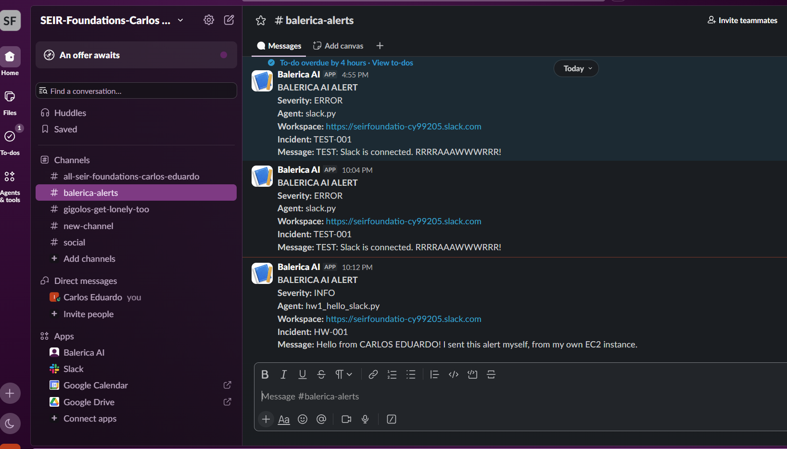

**hw2: all four severities with threshold INFO (HW-002)**
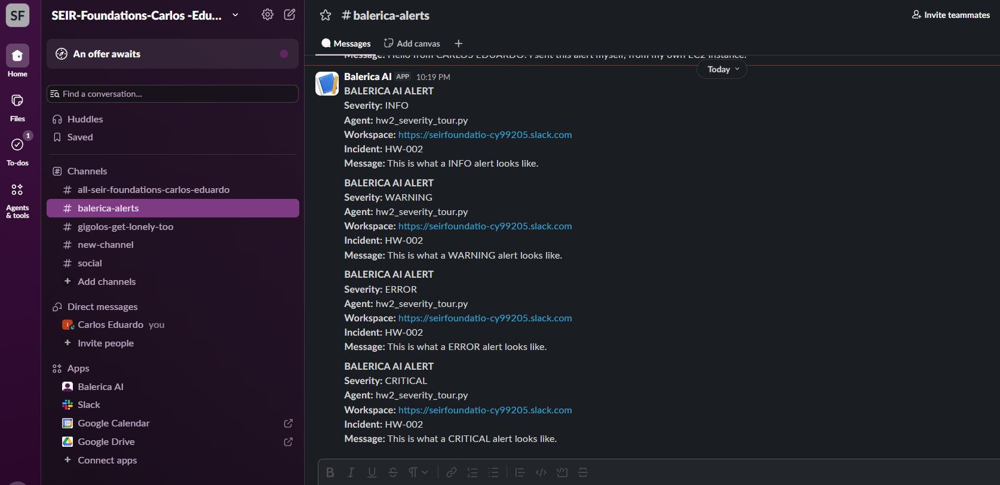

**hw3: server time in UTC (HW-003)**
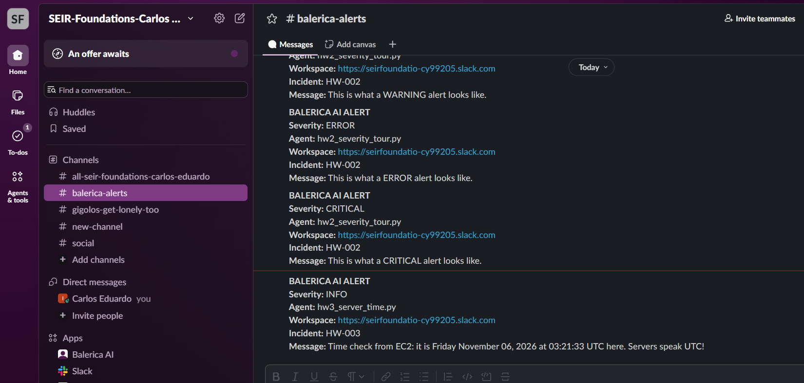

**hw4: disk check (HW-004)**
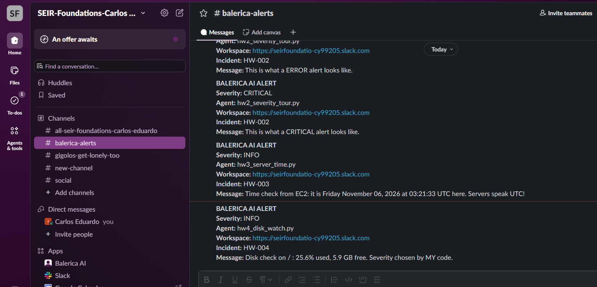

**hw5: load check (HW-005)**
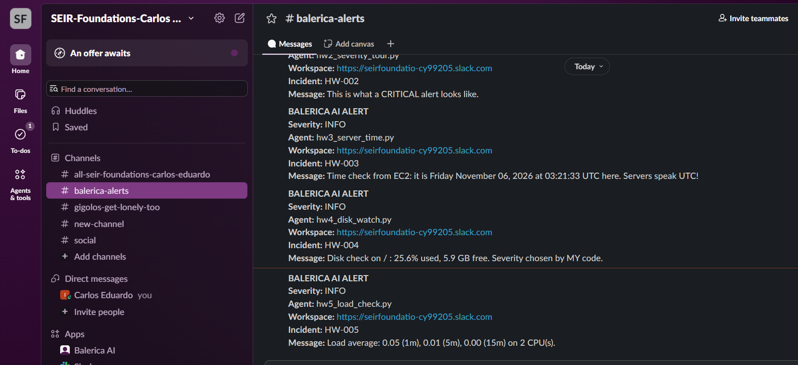

**hw6: incident drills (INFO, WARNING, ERROR, ERROR)**
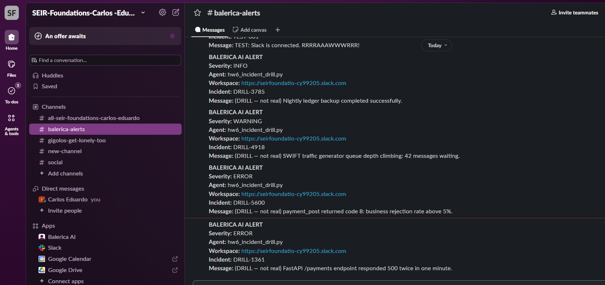

**hw7: morning report (HW-007)**
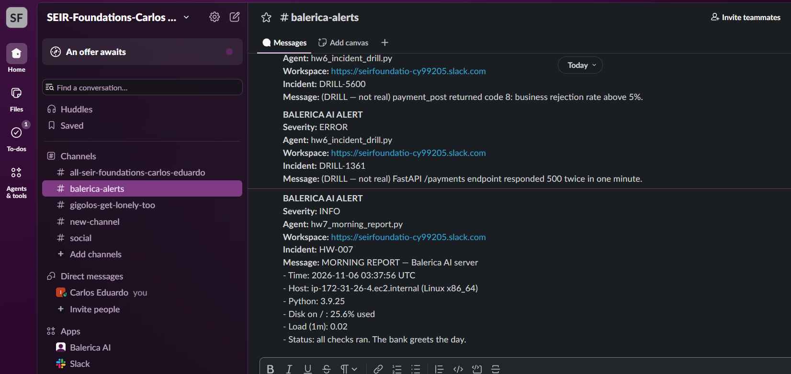

## Evidence: terminal, hw7 + ID line

Shows the morning report output followed by
`whoami && TZ='America/Chicago' date && ec2-metadata -i`.
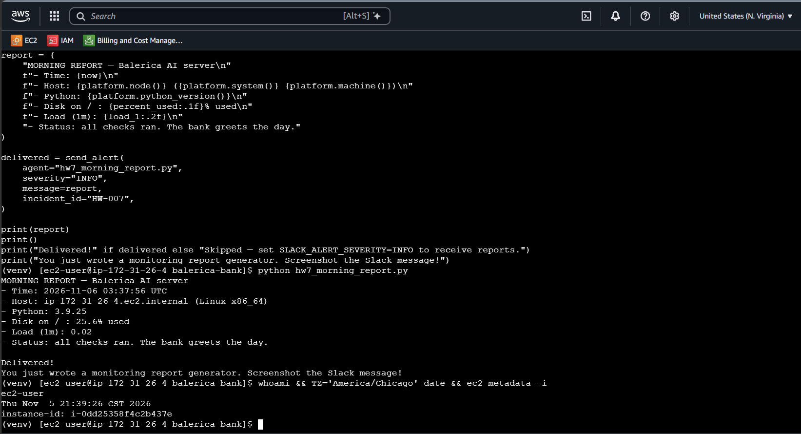

---

## Results

| # | Script | Result |
|---|--------|--------|
| 1 | `hw1_hello_slack.py` | Delivered "Hello from CARLOS EDUARDO!" |
| 2 | `hw2_severity_tour.py` | INFO, WARNING, ERROR, CRITICAL — all 4 delivered (threshold `INFO`) |
| 3 | `hw3_server_time.py` | Server reported Friday November 06, 2026 at 03:21:33 UTC |
| 4 | `hw4_disk_watch.py` | Disk 25.6% used, 5.9 GB free → INFO |
| 5 | `hw5_load_check.py` | Load 0.05 / 0.01 / 0.00 on 2 CPUs → INFO |
| 6 | `hw6_incident_drill.py` | INFO (ledger backup OK), WARNING (SWIFT queue at 42), ERROR (payment_post rejection rate above 5%), ERROR (/payments 500s) |
| 7 | `hw7_morning_report.py` | Multi-line morning report delivered (time, host, Python, disk, load) |

---

## Notes answers

hw1 and hw7 did not print an "In your notes:" question.

### hw2 — Which severities arrived, and WHY those?

Info, Warning, Error, and Critical. Each one is an indicator of the severity level.

### hw3 — How many hours apart are server time and YOUR wall clock?

5 hrs apart. Wall clock is 10:21PM EST server time is 03:21AM UTC.

### hw4 — Why is a quiet INFO here GOOD design, not a failure?

Because it's designed to report the status of the disk space even when there is no Warning, Error, or Critical severity.

### hw5 — What would make this number spike on the Balerica bank?

The number of messages waiting in queue would make the load spike.

### hw6 — Which of these fake incidents deserves to wake a human at 3 AM?

The Critical incident would.

---

## Experiments

### Experiment 1 — `SLACK_ALERT_SEVERITY=CRITICAL`, rerun hw2

- **Prediction:** 1
- **Result:** 1 — only the CRITICAL alert arrived.
- **Why:** The Critical severity arrived because the SLACK_ALERT_SEVERITY was set to Critical in the .env.

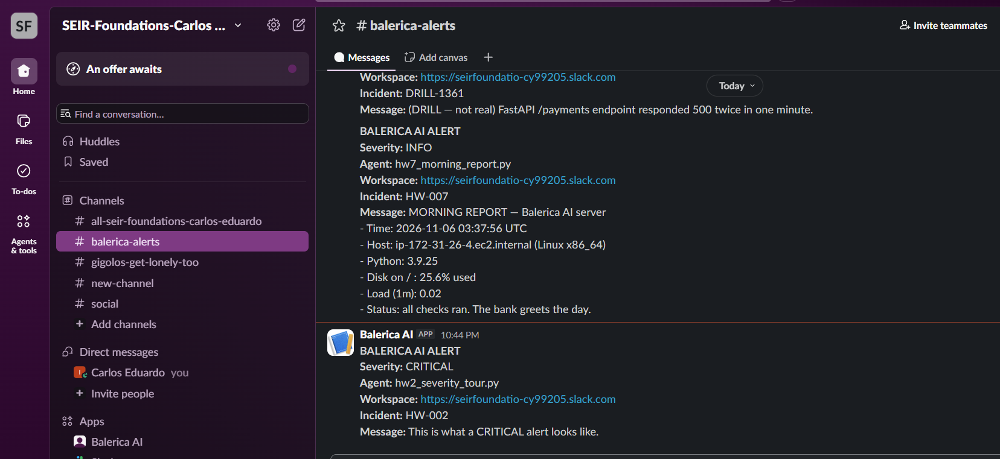

### Experiment 2 — `SLACK_ALERTS_ENABLED=false`, run hw1

- **What happened:** The script printed `Skipped.` and nothing was sent to Slack.
- **Why a kill switch is useful during maintenance:** The alert is skipped and not sent to Slack. SLACK_ALERTS_ENABLED must be true and SLACK_ALERT_SEVERITY=INFO for it to send. This is useful for testing alerts and to ensure false alerts are not sent out in error.

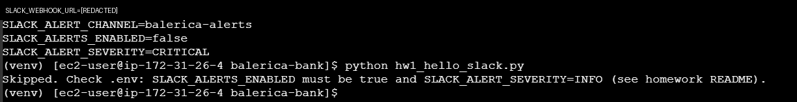

### Experiment 3 — Lower hw4's WARNING threshold below current disk usage

- **What happened:** Same disk usage (25.6%), but my code now chose WARNING instead of INFO.
- **Notes:** Because it's designed to report the status of the disk space even when there is no Warning, Error, or Critical severity.

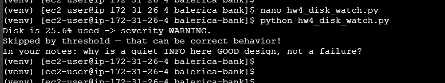

### Experiment 4 — Reset

- `.env` restored to `SLACK_ALERT_SEVERITY=INFO` and `SLACK_ALERTS_ENABLED=true`
- hw4 WARNING threshold restored to 75

---

## Rules followed

- Synthetic messages only. No passwords, keys, customer data, or `.env` contents were sent to Slack.
- No webhook URL appears in this repo or in the screenshots.
- `send_alert(agent, severity, message, incident_id)` interface left unchanged.
